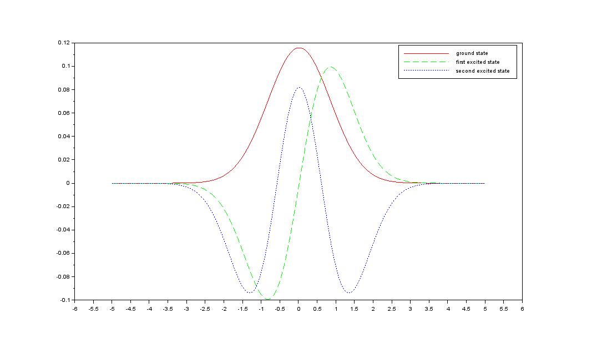
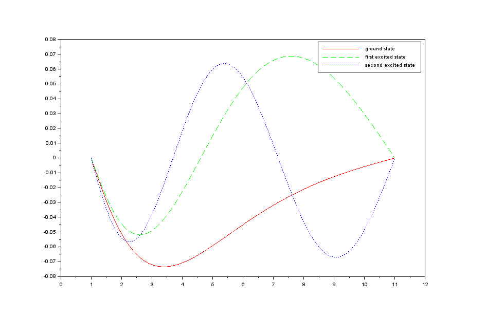
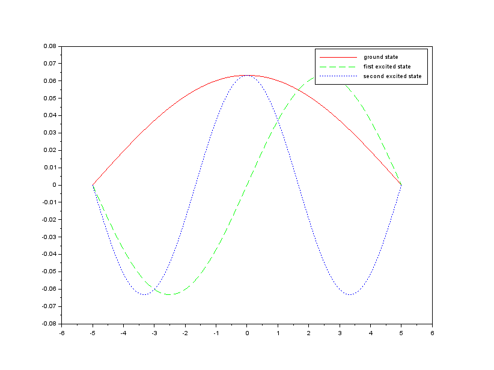
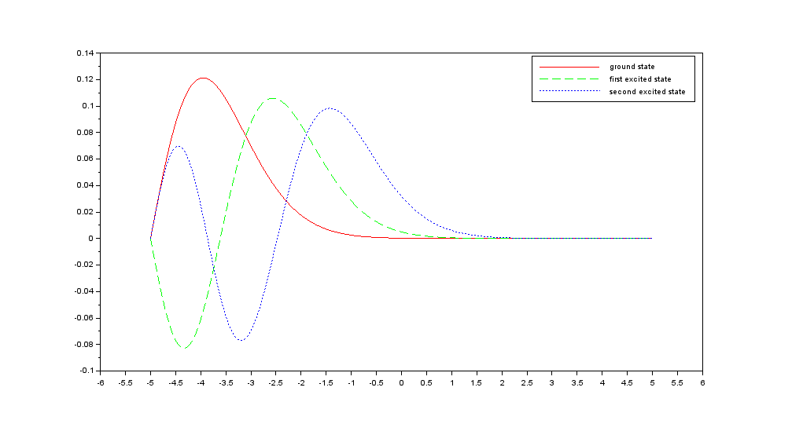
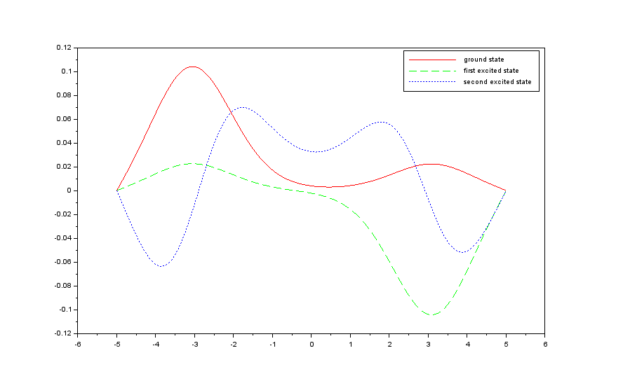

# Time-independent Schrödinger equation

**Eigenstates from finite differences in Scilab and Fortran**

[](LICENSE)
[](https://fortran-lang.org/)
[](https://www.scilab.org/)

This repository solves the 1D time-independent Schrödinger equation by
discretising it on a uniform grid and turning it into a matrix eigenvalue
problem. The Scilab script uses a harmonic-oscillator potential; the Fortran
program uses the Coulomb potential and LAPACK's `dsyev` for the diagonalisation.

**Author:** Zain Ul Abideen
**GitHub repository:** [dominuszain/TimeIndependentSchrodingerEquation](https://github.com/dominuszain/TimeIndependentSchrodingerEquation)

## Results

| | |
|---|---|
|  |  |
|  |  |
|  | |

## Scilab implementation

Open `main.sce` in Scilab and run it. The script builds the tridiagonal matrix

```
A(i,i)   = 2 + 2 m Δx² V(xᵢ) / ħ²
A(i,i±1) = -1
```

and calls `spec(A)` to obtain the lowest eigenstates. It plots the ground state
and the first two excited states for `V(x) = x²`. The report is
[`main.pdf`](main.pdf).

## Fortran implementation

[`Intel-Fortran/`](Intel-Fortran/) contains the version written for research use.
It builds the same matrix for `V(x) = -1/x`, calls `dsyev` from the Intel MKL,
and writes the eigenvalues and eigenvectors to `eigenout.txt`. Build and run with
`bash Intel-Fortran/run.sh` (requires Intel `ifx` and MKL).

## Method

With ħ = m = 1, the equation

```
-1/2 ψ'' + V(x) ψ = E ψ
```

is discretised with central differences:

```
-1/2 (ψᵢ₋₁ - 2ψᵢ + ψᵢ₊₁) / Δx² + Vᵢ ψᵢ = E ψᵢ
```

The resulting symmetric matrix is diagonalised, and its eigenvectors are the
sampled wave functions.

## Repository layout

```
.
├── Intel-Fortran/    # Fortran solver with LAPACK/MKL
├── docs/             # example eigenstates
├── main.sce          # Scilab solver
├── main.pdf          # report
├── CITATION.cff
└── LICENSE
```

## Citation

```bibtex
@software{ulabideen_tise_2026,
  author = {Ul Abideen, Zain},
  title  = {Time-independent Schrödinger equation: eigenstates from finite differences},
  year   = {2026},
  url    = {https://github.com/dominuszain/TimeIndependentSchrodingerEquation}
}
```

## License

Released under the [MIT License](LICENSE).
